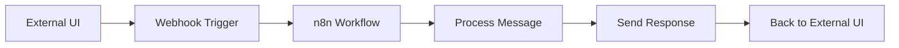
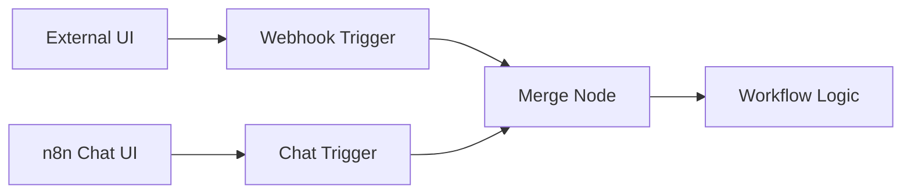

# n8n Workflow Invocation Methods
*Complete guide for triggering n8n workflows from external applications*

## 🎯 Overview: Ways to Invoke n8n Workflows

n8n workflows can be triggered in multiple ways, allowing seamless integration with external applications. Here are all the methods available:

| Method | Use Case | Real-time | Programmatic | External UI Support |
|--------|----------|-----------|--------------|-------------------|
| **Webhook Trigger** | REST API calls | ✅ Yes | ✅ Yes | ✅ Perfect |
| **HTTP Request** | API endpoints | ✅ Yes | ✅ Yes | ✅ Perfect |
| **Manual Trigger** | Button/UI activation | ❌ No | ✅ Via API | ✅ Good |
| **Schedule Trigger** | Time-based | ❌ No | ❌ No | ❌ No |
| **Chat Trigger** | Chat messages | ✅ Yes | ✅ Yes | ✅ Perfect |
| **Form Trigger** | Form submissions | ✅ Yes | ✅ Yes | ✅ Perfect |
| **Email Trigger** | Email events | ✅ Yes | ✅ Yes | ⚠️ Limited |

## 🚀 Best Methods for External Application Integration

### 1. **Webhook Trigger** ⭐ **(Most Popular)**

The Webhook trigger is the most flexible way to invoke workflows from external applications.

#### Setup in n8n:
```javascript
// Add Webhook trigger node to your workflow
Trigger: Webhook
- HTTP Method: POST (or GET)
- Path: /chat-message (custom path)
- Authentication: None/Basic/Header Auth
- Response: Immediately/When workflow completes
```

#### Call from External Application:
```javascript
// JavaScript example
fetch('https://your-n8n-instance.com/webhook/chat-message', {
  method: 'POST',
  headers: {
    'Content-Type': 'application/json',
    'Authorization': 'Bearer your-token' // if using auth
  },
  body: JSON.stringify({
    message: "Hello from external UI",
    userId: "user123",
    timestamp: new Date().toISOString(),
    channel: "support-chat"
  })
});
```

```python
# Python example
import requests

response = requests.post(
    'https://your-n8n-instance.com/webhook/chat-message',
    json={
        'message': 'Hello from external UI',
        'userId': 'user123',
        'timestamp': '2025-08-28T10:30:00Z',
        'channel': 'support-chat'
    },
    headers={'Authorization': 'Bearer your-token'}
)
```

```bash
# cURL example
curl -X POST \
  https://your-n8n-instance.com/webhook/chat-message \
  -H 'Content-Type: application/json' \
  -H 'Authorization: Bearer your-token' \
  -d '{
    "message": "Hello from external UI",
    "userId": "user123",
    "timestamp": "2025-08-28T10:30:00Z",
    "channel": "support-chat"
  }'
```

### 2. **n8n REST API** (Programmatic Execution)

You can use n8n's REST API to trigger workflows programmatically.

#### API Endpoint:
```javascript
POST /api/v1/workflows/{workflowId}/activate
POST /api/v1/executions
```

#### Example Implementation:
```javascript
// Start workflow execution via API
const triggerWorkflow = async (workflowId, inputData) => {
  const response = await fetch(`https://your-n8n-instance.com/api/v1/executions`, {
    method: 'POST',
    headers: {
      'Content-Type': 'application/json',
      'X-N8N-API-KEY': 'your-api-key'
    },
    body: JSON.stringify({
      workflowId: workflowId,
      data: inputData
    })
  });
  
  return response.json();
};

// Usage
triggerWorkflow('workflow-123', {
  message: "Chat message from external UI",
  user: "john@example.com"
});
```

### 3. **Chat Trigger** (For Chat-Specific Use Cases)

The Chat Trigger is specifically designed for chat applications and provides the best experience.

#### Setup:
```javascript
// n8n Chat Trigger configuration
Trigger: Chat Trigger
- Chat Type: Generic/Slack/Discord/Custom
- Authentication: API Key/OAuth
- Response Mode: Streaming/Complete
```

#### Integration Example:
```javascript
// External chat UI integration
class ChatInterface {
  constructor(n8nWebhookUrl) {
    this.webhookUrl = n8nWebhookUrl;
  }
  
  async sendMessage(message, userId) {
    // Send to n8n workflow
    const response = await fetch(this.webhookUrl, {
      method: 'POST',
      headers: {
        'Content-Type': 'application/json'
      },
      body: JSON.stringify({
        action: 'chat_message',
        message: message,
        userId: userId,
        timestamp: Date.now()
      })
    });
    
    // Handle n8n response
    const result = await response.json();
    this.displayResponse(result.response);
  }
  
  displayResponse(response) {
    // Update your UI with n8n workflow response
    document.getElementById('chat-container').innerHTML += 
      `<div class="bot-message">${response}</div>`;
  }
}

// Usage in your external UI
const chat = new ChatInterface('https://your-n8n.com/webhook/chat');

// When user clicks send button
document.getElementById('send-btn').onclick = () => {
  const message = document.getElementById('message-input').value;
  chat.sendMessage(message, 'current-user-id');
};
```

## 💻 Solving Your Specific Use Case

### Scenario: Chat Message Trigger from External UI

**Problem**: You have a chat trigger in n8n that requires manual user input, but you want to trigger it from a different UI.

**Solution**: Replace or supplement the chat trigger with a webhook trigger.

#### Option 1: Replace Chat Trigger with Webhook


#### Option 2: Hybrid Approach (Keep Both)


#### Implementation:

**Step 1: Modify n8n Workflow**
```javascript
// Original workflow:
[Chat Trigger] → [Process Message] → [Send Response]

// Modified workflow:
[Webhook Trigger] → [Process Message] → [Send Response]
// OR
[Webhook Trigger] ↘
                   [Merge] → [Process Message] → [Send Response]
[Chat Trigger]   ↗
```

**Step 2: External UI Integration**
```html
<!-- Your external UI -->
<div id="chat-interface">
  <div id="chat-messages"></div>
  <input type="text" id="message-input" placeholder="Type your message...">
  <button onclick="sendMessage()">Send</button>
</div>

<script>
async function sendMessage() {
  const message = document.getElementById('message-input').value;
  
  // Clear input
  document.getElementById('message-input').value = '';
  
  // Display user message
  addMessage(message, 'user');
  
  try {
    // Send to n8n workflow
    const response = await fetch('https://your-n8n.com/webhook/chat-handler', {
      method: 'POST',
      headers: {
        'Content-Type': 'application/json'
      },
      body: JSON.stringify({
        message: message,
        userId: getUserId(),
        sessionId: getSessionId(),
        timestamp: new Date().toISOString()
      })
    });
    
    const result = await response.json();
    
    // Display bot response
    addMessage(result.response, 'bot');
    
  } catch (error) {
    console.error('Error sending message:', error);
    addMessage('Sorry, there was an error processing your message.', 'error');
  }
}

function addMessage(text, type) {
  const chatDiv = document.getElementById('chat-messages');
  const messageDiv = document.createElement('div');
  messageDiv.className = `message ${type}`;
  messageDiv.textContent = text;
  chatDiv.appendChild(messageDiv);
  chatDiv.scrollTop = chatDiv.scrollHeight;
}
</script>
```

**Step 3: n8n Webhook Handler**
```javascript
// In your n8n webhook trigger node, access the data:
{
  "message": "{{ $json.message }}",
  "userId": "{{ $json.userId }}",
  "sessionId": "{{ $json.sessionId }}",
  "timestamp": "{{ $json.timestamp }}"
}

// Process the message in subsequent nodes
// Return response in "Respond to Webhook" node
{
  "response": "{{ $json.processedResponse }}",
  "status": "success"
}
```

## 🔧 Advanced Integration Patterns

### 1. **Real-time Chat with Streaming Response**

```javascript
// For real-time responses, use Server-Sent Events
class StreamingChat {
  constructor(webhookUrl) {
    this.webhookUrl = webhookUrl;
  }
  
  async sendStreamingMessage(message) {
    const response = await fetch(this.webhookUrl, {
      method: 'POST',
      headers: {
        'Content-Type': 'application/json',
        'Accept': 'text/event-stream'
      },
      body: JSON.stringify({
        message: message,
        streaming: true
      })
    });
    
    const reader = response.body.getReader();
    const decoder = new TextDecoder();
    
    while (true) {
      const { value, done } = await reader.read();
      if (done) break;
      
      const chunk = decoder.decode(value);
      this.updateChatBubble(chunk);
    }
  }
}
```

### 2. **Authentication and Security**

```javascript
// Secure webhook with authentication
const authenticatedWebhook = async (message, authToken) => {
  return fetch('https://your-n8n.com/webhook/secure-chat', {
    method: 'POST',
    headers: {
      'Content-Type': 'application/json',
      'Authorization': `Bearer ${authToken}`,
      'X-User-ID': getCurrentUserId(),
      'X-Session-ID': getSessionId()
    },
    body: JSON.stringify({
      message: message,
      metadata: {
        userAgent: navigator.userAgent,
        timestamp: Date.now(),
        source: 'external-ui'
      }
    })
  });
};
```

### 3. **Error Handling and Fallbacks**

```javascript
// Robust error handling
class RobustChatClient {
  constructor(primaryWebhook, fallbackWebhook) {
    this.primary = primaryWebhook;
    this.fallback = fallbackWebhook;
    this.retryCount = 0;
    this.maxRetries = 3;
  }
  
  async sendMessage(message) {
    try {
      return await this.tryWebhook(this.primary, message);
    } catch (error) {
      console.warn('Primary webhook failed, trying fallback');
      try {
        return await this.tryWebhook(this.fallback, message);
      } catch (fallbackError) {
        return this.handleFailure(message);
      }
    }
  }
  
  async tryWebhook(url, message) {
    const response = await fetch(url, {
      method: 'POST',
      headers: { 'Content-Type': 'application/json' },
      body: JSON.stringify({ message }),
      timeout: 10000 // 10 second timeout
    });
    
    if (!response.ok) {
      throw new Error(`HTTP ${response.status}`);
    }
    
    return response.json();
  }
  
  handleFailure(message) {
    // Store message for retry or show error
    localStorage.setItem('failedMessage', JSON.stringify({
      message,
      timestamp: Date.now()
    }));
    
    return {
      response: "I'm having trouble right now. Your message has been saved and I'll respond soon.",
      error: true
    };
  }
}
```

## 📊 Comparison of Trigger Methods

### For External UI Integration:

| Method | Setup Difficulty | Flexibility | Real-time | Security | Best For |
|--------|-----------------|-------------|-----------|----------|----------|
| **Webhook** | Easy | High | Yes | Good | General purpose |
| **Chat Trigger** | Medium | Medium | Yes | Good | Chat-specific |
| **Form Trigger** | Easy | Low | Yes | Good | Form submissions |
| **API Execution** | Hard | High | Yes | High | Complex workflows |

### Recommended Architecture:

```
External UI → Webhook Trigger → n8n Workflow → Response → External UI
     ↓              ↓                ↓             ↓
  User Input → HTTP POST → Process Logic → JSON Response
```

## 🎯 Best Practices

### 1. **URL Structure**
```
https://your-n8n-instance.com/webhook/chat-handler
https://your-n8n-instance.com/webhook/support-ticket
https://your-n8n-instance.com/webhook/user-action
```

### 2. **Data Format**
```javascript
// Consistent payload structure
{
  "action": "chat_message",
  "data": {
    "message": "user message",
    "userId": "user123",
    "sessionId": "session456"
  },
  "metadata": {
    "timestamp": "2025-08-28T10:30:00Z",
    "source": "external-ui",
    "version": "1.0"
  }
}
```

### 3. **Response Handling**
```javascript
// Standard response format
{
  "success": true,
  "data": {
    "response": "Bot response message",
    "actions": ["follow-up-action"],
    "metadata": {}
  },
  "error": null
}
```

Would you like me to create specific implementation examples for your chat use case or help you set up any of these integration methods?
